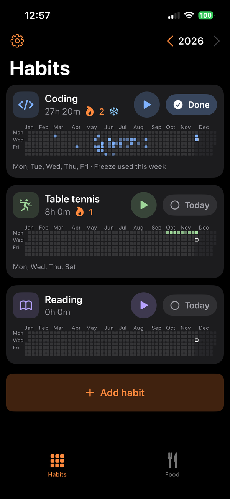
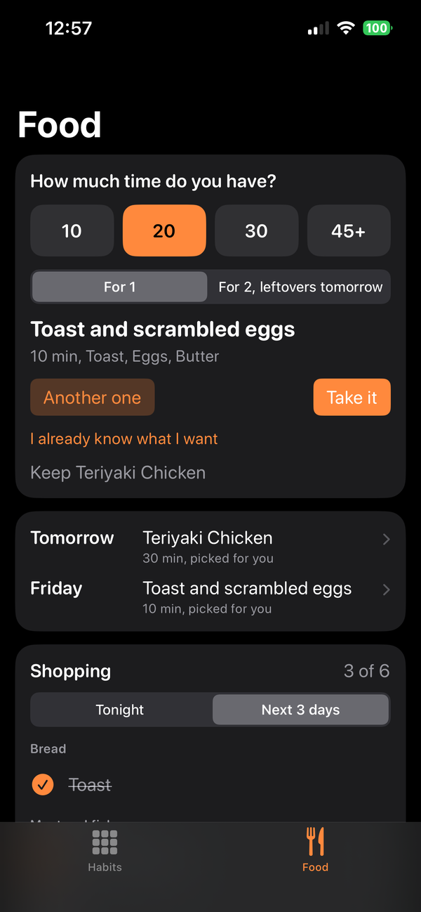
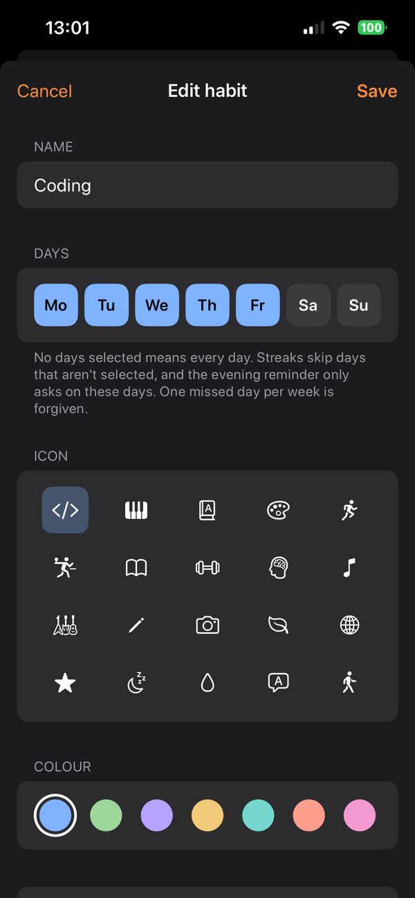

# Heatmap

A small habit tracker with a food helper, built from Linux/Windows with xtool.

<p align="center">
  
  
  
</p>

## Habits
- Heatmap cards for each habit: streak, Done, focus timer
- Streaks skip days a habit isn't scheduled on, and forgive one missed day per week (snowflake)
- Focus timer shows on the lock screen (and Dynamic Island) as a Live Activity; tap it to open the timer
- Evening reminder lists only habits still open; press and hold it to tick them off

## Food
- "How much time do you have?" picks a meal that fits, avoiding recent ones; "Another one" rerolls
- If you haven't chosen by the deadline (16:30), the app's pick stays, and a reminder says what's
  for dinner and what's still missing
- Shopping list for tonight or the next 3 days, sorted in the order you normaly walk through a supermarket
- Your meals: name, cooking time, ingredients with their supermarket section
- Your storage: what's at home. Ticking a shopping item adds it, "Cooked" takes out what's used up

## Build and install (Linux)

```bash
sudo pacman -S --needed usbmuxd libimobiledevice fuse2 zip
# xtool 2.0 beta is needed for the widget's App Group on a free account
curl -fL "https://github.com/xtool-org/xtool/releases/download/2.0.0-beta.1/xtool-x86_64.AppImage" -o xtool
chmod +x xtool && sudo mv xtool /usr/local/bin/
cd ~/Heatmap && xtool dev
```

Renew every 7 days with `xtool dev`. The data stays.

## Project layout
- `Sources/Shared`: data model, storage, heatmap drawing, Live Activity attributes
- `Sources/Heatmap`: app (habits, food, settings, reminders)
- `Sources/HeatmapWidget`: home screen widget and the Live Activity
- `App-Info.plist`: enables Live Activities
- `Resources/AppIcon.png`: icon
## License

MIT, see [LICENSE](LICENSE).
